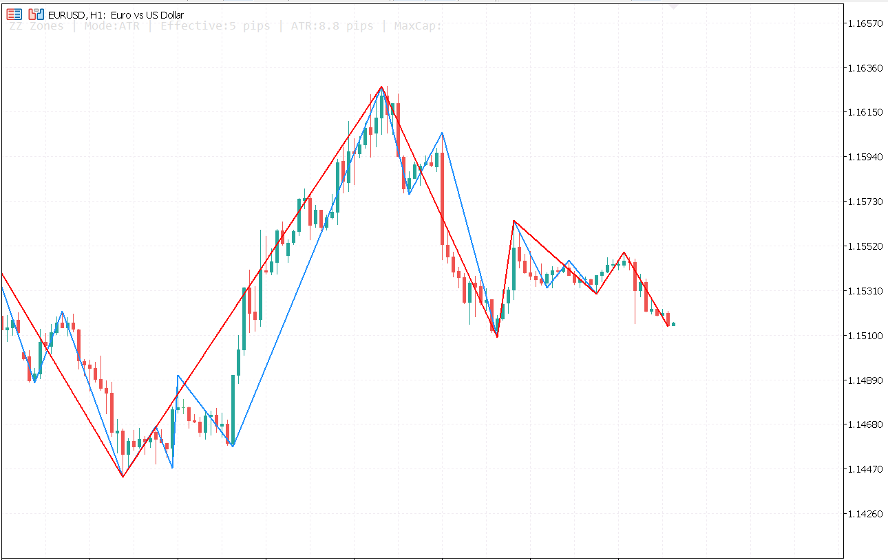
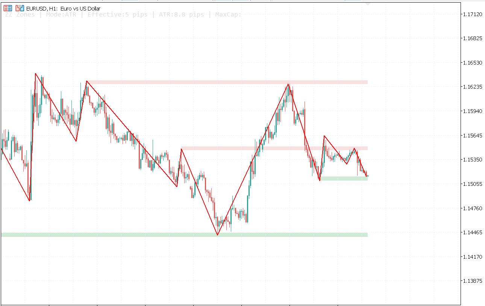
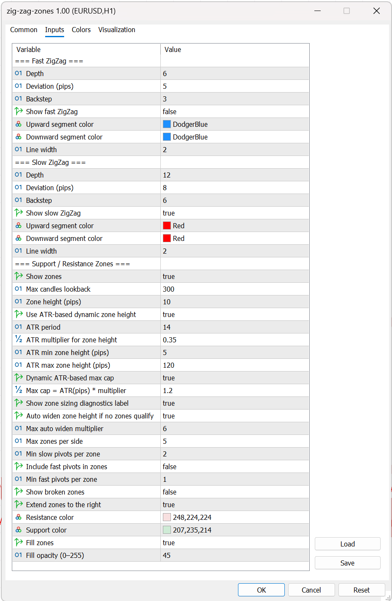

# Zig Zag Zones MT5 — Dual ZigZag Support and Resistance Zones for MetaTrader 5

> **Free MT5 indicator.** Plot a **Fast** and **Slow ZigZag** on the same chart and automatically draw **support and resistance zones** from repeated swing pivots, with optional **ATR-based dynamic zone sizing**.

---

---

## Table of Contents

- [Overview](#overview)
- [Features](#features)
- [How Zones Are Built](#how-zones-are-built)
- [Installation](#installation)
- [Settings Reference](#settings-reference)
- [How to Use](#how-to-use)
- [Compatibility](#compatibility)
- [Changelog](#changelog)
- [License](#license)

---

## Overview

**Zig Zag Zones MT5** is a free MetaTrader 5 indicator that combines two independent ZigZag structures with automatic support and resistance zone detection.

The indicator runs a **Fast ZigZag** and a **Slow ZigZag** in parallel, then groups repeated pivot highs and lows into visual price zones. By default, zones are derived from the **Slow ZigZag**, with optional confirmation from **Fast ZigZag** pivots. Zone height can be fixed in pips or scaled automatically using **ATR**, which makes the indicator adapt better to changing volatility.

This makes it useful for traders who want to map swing structure, identify reaction areas, and keep key support/resistance zones visible on the chart without drawing them manually.

---

## Features

| Feature | Detail |
|---|---|
| **Dual ZigZag engine** | Fast and Slow ZigZag lines run independently with separate Depth, Deviation, and Backstep settings |
| **Automatic S/R zones** | Repeated pivot highs form resistance zones; repeated pivot lows form support zones |
| **Slow-pivot driven logic** | Zones are built from Slow ZigZag pivots by default for cleaner structure mapping |
| **Optional fast-pivot confirmation** | Include Fast ZigZag pivots in the zone-building process when you want tighter validation |
| **ATR-based zone sizing** | Zone height can adapt to live volatility using ATR |
| **Fixed-pip fallback** | Use a constant zone height if you prefer manual control |
| **Auto-widen mode** | If no zones qualify at the current height, the indicator can progressively widen the zone size |
| **Broken-zone filtering** | Hide broken zones or show them with dotted outlines |
| **Right-extension support** | Extend active zones to the right so they remain visible as future reaction areas |
| **Chart diagnostics label** | Optional on-chart label shows current sizing mode, ATR value, effective zone height, and cap |
| **Visual customisation** | Configure ZigZag colours, widths, zone colours, fill, and opacity |
| **Works in chart window** | The indicator is fully visual and designed to coexist with normal MT5 chart workflows |

---

## How Zones Are Built

The zone logic is straightforward:

1. The indicator calculates **Fast** and **Slow** ZigZag pivots.
2. It collects recent pivot highs and lows within the configured **lookback** window.
3. Nearby pivots are merged into a shared zone when they fall within the allowed zone height.
4. A zone is drawn only if it meets the minimum pivot requirements.
5. Zones are sorted by proximity to the current price, and the closest valid zones are drawn first.

Important behaviour:

- **Resistance zones** come from clustered ZigZag highs.
- **Support zones** come from clustered ZigZag lows.
- **Slow pivots** are mandatory for qualification.
- **Fast pivots** are optional and can be added as extra confirmation.
- A zone is considered **broken** when current price moves above resistance or below support.
- Broken zones can be hidden or displayed with a dotted border.

When **ATR zone sizing** is enabled, the effective zone height is based on:

- `ATR(period) * ATR multiplier`
- A minimum cap in pips
- A maximum cap in pips, optionally derived from ATR again

If **Auto Zone Height** is enabled, the indicator can widen the effective zone size step by step until valid zones are found, up to the configured multiplier.

---

---

## Installation

### Requirements

- MetaTrader 5
- This repository, or a compiled `.ex5` build of the indicator

### From Source

1. Copy [`src/fxtt-zig-zag-zones-mt5.mq5`](src/fxtt-zig-zag-zones-mt5.mq5) and its dependency folder(s) into your MT5 **Data Folder**.
2. In MetaTrader 5, go to **File → Open Data Folder**.
3. Place the files under **MQL5 → Indicators** while preserving the folder structure required by the includes.
4. Open `fxtt-zig-zag-zones-mt5.mq5` in **MetaEditor**.
5. Press **Compile**.
6. Back in MT5, refresh the **Navigator** and attach the indicator to a chart.

### Using a Compiled File

1. Copy the compiled `.ex5` file into **MQL5 → Indicators**.
2. In MT5, refresh the **Navigator**.
3. Drag the indicator onto any chart.

### Troubleshooting

| Problem | Solution |
|---|---|
| Indicator does not appear in Navigator | Confirm the file was copied to `MQL5/Indicators` and compiled successfully |
| Compilation fails on include file | Make sure the dependency `FxTT/ZigZag/CZigZag.mqh` exists in the expected include path |
| No zones appear | Increase `Zone Lookback`, reduce pivot requirements, or enable `Auto Zone Height` |
| Zones appear too wide or too narrow | Adjust `Zone Height`, `ATR Multiplier`, and ATR min/max caps |
| Broken zones disappear unexpectedly | This is expected when `Show Broken` is disabled |
| Debug label is visible but unwanted | Disable `Show Zone Debug Label` |

---

## Settings Reference

All settings are available from the MT5 **Inputs** tab.

### Fast ZigZag

| Parameter | Default | Description |
|---|---|---|
| **Depth** | `6` | Minimum swing depth for the fast structure |
| **Deviation (pips)** | `5` | Minimum price movement required to form a pivot |
| **Backstep** | `3` | Minimum spacing between pivots |
| **Show fast ZigZag** | `true` | Show or hide the fast line |
| **Upward segment color** | `DodgerBlue` | Colour used for rising fast ZigZag segments |
| **Downward segment color** | `DodgerBlue` | Colour used for falling fast ZigZag segments |
| **Line width** | `2` | Fast ZigZag line thickness |

### Slow ZigZag

| Parameter | Default | Description |
|---|---|---|
| **Depth** | `12` | Minimum swing depth for the slow structure |
| **Deviation (pips)** | `8` | Minimum price movement required to form a pivot |
| **Backstep** | `6` | Minimum spacing between pivots |
| **Show slow ZigZag** | `true` | Show or hide the slow line |
| **Upward segment color** | `Red` | Colour used for rising slow ZigZag segments |
| **Downward segment color** | `Red` | Colour used for falling slow ZigZag segments |
| **Line width** | `2` | Slow ZigZag line thickness |

### Support / Resistance Zones

| Parameter | Default | Description |
|---|---|---|
| **Show zones** | `true` | Master toggle for drawing support and resistance zones |
| **Zone Lookback** | `300` | Number of candles scanned for qualifying pivots |
| **Zone Height** | `10` | Fixed zone height in pips when ATR mode is disabled |
| **Use ATR-based dynamic zone height** | `true` | Size zones from ATR instead of fixed pips |
| **ATR Period** | `14` | ATR lookback period |
| **ATR Multiplier** | `0.35` | Converts ATR into zone height |
| **ATR min zone height (pips)** | `5` | Minimum zone size allowed in ATR mode |
| **ATR max zone height (pips)** | `120` | Static maximum zone size when dynamic max cap is off |
| **Dynamic ATR-based max cap** | `true` | Cap max zone size with `ATR * max cap multiplier` |
| **ATR Max Cap Multiplier** | `1.20` | Multiplier used for the dynamic ATR max cap |
| **Show zone debug label** | `true` | Shows current sizing diagnostics on the chart |
| **Auto widen zone height** | `true` | Gradually widen zone height if no zones qualify |
| **Max auto widen multiplier** | `6` | Maximum widening factor for auto-height logic |
| **Max zones per side** | `5` | Maximum resistance zones and support zones shown |
| **Min slow pivots per zone** | `2` | Minimum slow-pivot touches required |
| **Include fast pivots in zones** | `false` | Use Fast ZigZag pivots as additional qualifiers |
| **Min fast pivots per zone** | `1` | Minimum fast-pivot touches when fast pivots are enabled |
| **Show broken** | `false` | Display broken zones instead of hiding them |
| **Extend zones to the right** | `true` | Project active zones forward |
| **Resistance color** | `248,224,224` | Resistance rectangle colour |
| **Support color** | `207,235,214` | Support rectangle colour |
| **Fill zones** | `true` | Fill the rectangles instead of outline-only |
| **Fill opacity** | `45` | Zone fill transparency from `0` to `255` |

---

## How to Use

### Map Major Swing Structure

Use the **Slow ZigZag** to identify the broader market structure and the **Fast ZigZag** to inspect shorter-term swing detail inside that structure.

Typical approach:

1. Keep both ZigZags visible.
2. Use the slow line to identify key highs and lows.
3. Watch where multiple slow pivots cluster into a zone.
4. Use the fast line to time reactions inside or near those zones.

### Build Cleaner Zones

If your chart becomes noisy:

- Increase **Slow Depth**
- Increase **Zone Height**
- Raise **Min Slow Pivots per Zone**
- Disable **Include Fast Pivots in Zones**

This will usually produce fewer but more meaningful zones.

### Make Zones More Reactive

If you want the indicator to react faster to recent market behaviour:

- Lower **Slow Depth**
- Enable **Include Fast Pivots in Zones**
- Reduce **Zone Height**
- Keep **ATR-based dynamic zone height** enabled

This will produce tighter and more adaptive zones, but with more sensitivity.

### Use Broken Zones as Context

A broken resistance zone can become a future support reference. A broken support zone can become future resistance. If you want to study those transitions, enable **Show Broken** and keep the dotted zone outlines visible.

### Practical Trading Workflow

1. Let the indicator plot the nearest support and resistance zones.
2. Use the **Slow ZigZag** to define the dominant swing direction.
3. Watch price as it approaches the closest zone.
4. Use the **Fast ZigZag** and your entry model to confirm rejection, continuation, or breakout.
5. Manage risk based on zone width and surrounding market structure.

> **Note:** ZigZag-based tools depend on swing confirmation and are not standalone trade signals. Use them with price action context and risk management.

---

## Compatibility

| | |
|---|---|
| **Platform** | MetaTrader 5 |
| **Window Type** | Main chart window |
| **Symbols** | Forex, metals, indices, crypto, and other MT5-supported instruments |
| **Timeframes** | Any MT5 chart timeframe |
| **Operating System** | Windows, macOS via compatibility layer, VPS |
| **Expert Advisors** | Visual indicator; intended to coexist with normal chart workflows |
| **MT4** | Not compatible |

---

## Changelog

| Version | Date | Notes |
|---|---|---|
| **1.00** | April 2026 | Initial release. Dual ZigZag rendering, automatic support/resistance zones, ATR-based dynamic zone height, auto-widen logic, optional fast-pivot inclusion, broken-zone filtering, right-extension, and on-chart zone diagnostics. |

---

## License

This indicator is provided **free of charge** for personal use. Redistribution, resale, or repackaging without permission is not permitted.

© [Forex Trading Tools](https://www.forextradingtools.eu)
